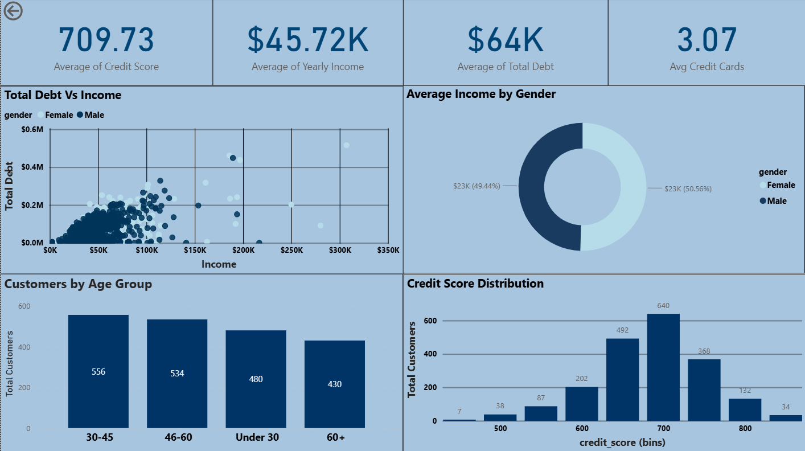
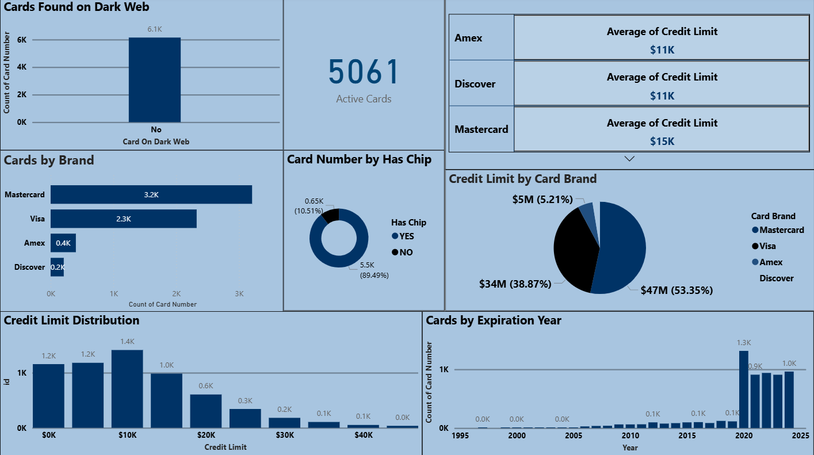
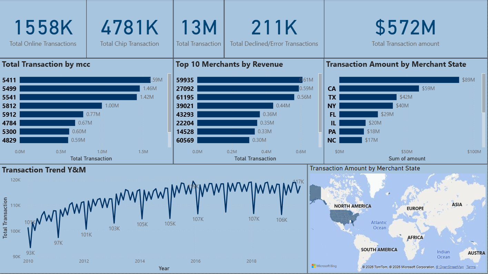
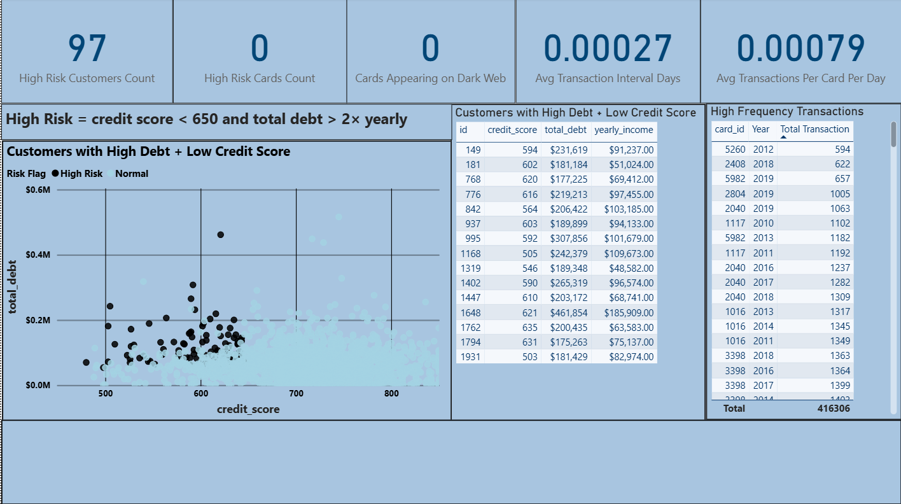

# 🛡️ Credit Card Risk & Fraud Analytics Dashboard

## 📌 Project Overview
An end-to-end Business Intelligence solution analyzing **13M+ credit card transactions** ($572M total volume) across **6,146 cards** and **2,000 customers**. This multi-page Power BI report tracks executive KPIs, customer demographics, card portfolio distribution, merchant transaction trends, and high-risk fraud indicators.

## 🛠️ Tools & Technologies
* **Microsoft Power BI:** Multi-page Interactive Dashboards, Dynamic Slicers, Custom Navigation, and Geospatial Mapping.
* **Data Modeling:** Star Schema architecture linking Transaction Fact tables with Customer, Card, and Merchant Dimension tables.
* **DAX:** Custom calculated columns, risk flagging logic (`Credit Score < 650` & `Total Debt > 2x Yearly Income`), and time-intelligence measures.

---

## 📊 Dashboard Pages & Preview

### 1. Management Overview
High-level executive summary tracking total customers (2,000), issued cards (6,146), total transaction volume ($572M), average ticket size ($43), and payment method breakdown.

### 2. Customers Insight
Demographic and financial health analysis covering average credit score (709.73), yearly income ($45.72K), total debt ($64K), and debt-to-income distribution across age groups and gender.

### 3. Card Portfolio Analysis
Detailed breakdown of the 5,061 active cards across brands (Mastercard, Visa, Amex, Discover), chip adoption (89.49%), credit limit distribution, and dark web exposure monitoring.

### 4. Transaction Analysis
Deep dive into transaction channels (Chip vs. Online), top revenue-generating merchants and MCC categories, declined/error transactions (211K), and geographic distribution across US states.

### 5. Risk & Fraud Detection
Dedicated risk monitoring page isolating **97 high-risk customers** based on low credit score (<650) and high debt-to-income ratios, alongside high-frequency transaction velocity tracking.

---

## 💡 Key Analytical Insights

* **Risk Segmentation:** Isolated 97 high-risk customer profiles combining sub-650 credit scores with total debt exceeding twice their annual income for targeted monitoring.
* **Portfolio & Channel Dynamics:** Debit cards account for 63.06% of issued cards, while chip-enabled cards represent nearly 90% of the portfolio, driving the majority of transaction volume.
* **Merchant & Geographic Concentration:** Identified top-performing MCC codes (5411, 5499, 5541) and key revenue states led by California ($59M), Texas ($42M), and New York ($40M).
* **Risk Segmentation:** Isolated 97 high-risk customer profiles combining sub-650 credit scores with total debt exceeding twice their annual income for targeted monitoring.
* **Portfolio & Channel Dynamics:** Debit cards account for 63.06% of issued cards, while chip-enabled cards represent nearly 90% of the portfolio, driving the majority of transaction volume.
* **Merchant & Geographic Concentration:** Identified top-performing MCC codes (5411, 5499, 5541) and key revenue states led by California ($59M), Texas ($42M), and New York ($40M).
